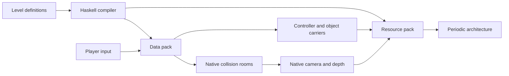

# Architecture

Manifold maintains one logical puzzle state and projects nearby geometry into two physical room caches. The data pack owns interaction and collision; the resource pack reconstructs the camera and renders the periodic world. Both are compiled from the same level definitions.

## Domain and resource compiler

| Module | Responsibility |
| --- | --- |
| `Gravity` | Fixed-point vectors, 24 orientation frames, gravity selection, and beam collision |
| `Stage` and `Stage.Collision` | Native block geometry, room transforms, swept contacts, and surface finishes |
| `Scene` | Static solids, door apertures, periodic images, and spatial buckets |
| `Objects` | Cube identities, phases, support dependencies, and active movement |
| `Joinery` | Connected timber shapes, three-dimensional translations, swept interlocks, and reversible assembly |
| `ThreeRings` | The three-cube level's architecture, sockets, circuits, and rendering hierarchy |
| `Protocol` | Shared wire fields and incremental command encoding |
| `Pipeline` and `Program` | Render targets, pass dependencies, and playable/diagnostic profiles |
| `Messages` | English and Simplified Chinese text components and language resources |
| `Pack` | Resource assembly and build metadata |

`Scene.compileScene` cuts door apertures out of static masonry before emitting either representation. `canonicalSolids` clips periodic images into one lattice cell for ray traversal. Native collision queries and shader intersections therefore see the same openings and boundaries.

The generator validates cube definitions, circuit references, and render-graph dependencies. Resource names and command serialization are generated from these models.

## Coordinates and gravity

Positions use 4,096 fixed-point units per block. Logical space is periodic: 64 blocks per axis in Three Rings and Joinery Court, and 32 in Atrium. A frame consists of three orthogonal unit vectors; its down direction selects one of the six gravity axes.

Minecraft's native player remains vertically oriented in a rotated physical room. The shader maps that room and its camera back into logical space. Consequently, F3 coordinates describe the physical cache rather than the coordinates used by level definitions.

| Movement mode | Owner | Behavior |
| --- | --- | --- |
| Free flight | Logical controller | Spectator input drives exploration |
| Native movement | Minecraft | Adventure or Survival movement, jumping, collision, and interaction |
| Gravity transition | Logical controller | Fixed-point integration and swept collision while the camera rotates |
| Room preparation | Cache manager | Prepare entry or a landing, then resume native movement |

The controller ticks at 20 Hz. Sweeps clip displacement to the first solid face. The GPU interpolates controller motion and blends gravity orientation over 0.4 seconds. Native movement reads the current rendered camera directly.

## Local room caches

The two physical origins are `(0, 200, 0)` and `(80, 200, 0)` in `manifold:stage`. Three Rings projects a 32-block window with a six-block halo into the active cache. The halo covers interaction reach, eye offsets, and geometry around a periodic seam.

Crossing a window boundary rebases the player with an integer relative teleport. Logical position, velocity, gravity frame, and carried-object identity continue across the seam. Both cache origins are sent to the shader, which selects the origin associated with the camera's physical room.

Reusing a known cache clears its previous orientation's 44 × 44 × 44 block envelope: 85,184 block positions. Initialization uses the envelope covering every orientation. Room construction is an event cost; its block visits must be measured separately from ordinary tick command counts.

## Objects and circuits

A cube has a stable identity, a cell, a bound gravity direction, and a phase: resting, carried, or moving. Cubes aligned with the current gravity can move along the block grid until supported. Other cubes freeze and can become landing surfaces. A moving cube waits if its next cell intersects the player.

Static collision uses 16-block buckets. Dynamic occupancy and room projection use 8-block buckets. Command storage holds authoritative object records; marker entities represent active motion, and nearby interaction proxies support native clicks. Carried cubes keep their world orientation while their rendered position follows the hand.

Support changes queue affected objects. Circuit inputs subscribe to object identities, and queued circuits are evaluated once per change batch. Three Rings uses blue and green as alternate supplies for the gallery, and amber as the supply for the green court. All three final sockets determine completion.

Adding a cube changes the authored definition and its generated resources. Dormant objects do not receive separate global tick functions. Local density still affects collision queries and materialization; authored visible objects also add rendering and object-snapshot work.

## Scheduling

| Entry point | Work | When it runs |
| --- | --- | --- |
| `session/tick` | Session checks and final publication | Once per active-player tick |
| `hybrid/native` | Read native position, rebase windows, dispatch interaction and turn input | Native movement |
| `hybrid/air` | Integrate velocity, sweep collisions, prepare a landing | Gravity transition |
| `hybrid/waiting` | Prepare rooms or count down the handoff | Entry and landing preparation |
| `objects/tick` | Advance active cubes and drain support notifications | Active Three Rings session |
| `objects/interaction` | Resolve a cube click | Native interaction advancement |
| `objects/cursor` | Resolve a placement outline | While carrying a cube |
| `circuits/drain` | Evaluate subscribed circuits | State-change batch |
| `level/build/*` | Materialize a room and nearby objects | Entry, reset, landing, or cache refresh |
| `objects/bank/publish` | Publish an object snapshot | Object or preview change |

An active player executes one movement phase per tick. State changes request publication; the session wrapper publishes once after the tick completes. Commands invoked outside the tick publish immediately.

## Pixel transport

The control header uses seven RGB24 words. It includes position, gravity frame, sequence and epoch, level, movement mode, cache origins, puzzle flags, and the object revision. The incremental encoder caches each field's contribution and writes changed words.

Three Rings uses a second `item_display` for its object snapshot. With three cubes, this contains six words: three cube records, a placement preview, a marker, and a revision. Together with 22 camera words, the current packet occupies 35 pixels.

The receiver accepts the object snapshot when its revision matches the control header. Both carriers follow the player. A brief visibility or revision gap retains the last complete scene for up to 0.75 seconds; fresh camera data resumes rendering.

## Rendering

The pipeline receives the carrier packet, updates persistent frame state, renders the selected quality target, and composites the scene with native depth. The diagnostic profile adds a GPU observation pass to the same graph. Joinery adds a bounded light-field pass and a final antialiasing/interface pass. Its contact shadows, soft shadow visibility and wood finish share the authoritative geometry used for collisions. Surface distance queries use the timber envelopes as conservative bounds.

Joinery's presentation pass draws its HUD after antialiasing. Packet retention copies the already-presented frame, preserving both the world and interface without accumulating filtering.

Three Rings traverses periodic cells in ray order and uses a compiled box hierarchy to find the nearest exact intersection. Geometry crossing cell boundaries is represented in every participating cell. The same intersection query validates native depth and supplies architecture while native chunk meshes update.

Atrium uses signed-distance tracing outside its native windows. Surface projection, pixel-footprint-aware outlines, and bevel shading keep nearby and distant materials consistent. Cubes display gravity arrows on four side faces, with inward/outward marks on their two end faces.

## Level adapters and persistence

`Level.DataPack` dispatches validation, reset, activation, interaction, collision, wrapping, construction, and cleanup hooks. A new level implements its adapter and registers it with this dispatcher. Collision hooks shorten `g.step` or set `g.blocked`; build hooks receive a slot and frame.

Three Rings checkpoints store the player pose, cube records, occupancy indexes, circuits, and completion state together. Respawn restores that checkpoint. Three Rings and its room caches carry layout versions for their respective rebuild rules.

See [development](development.md) for native verification and workload measurements.

## Rigid joinery

Joinery Court's six rigid members are unions of occupied four-block modules. Greedy box merging preserves their notches for both native projection and periodic ray intersections. Each member holds an xyz module offset and translates four blocks in any current gravity direction. Relative-offset obstruction regions derive from complete swept occupancy. The home configuration partitions the full timber envelopes exactly; generation validates coverage, disjoint ownership and member connectivity.

The held tool's use statistic triggers a logical voxel ray query, including repeated geometry beyond the native collision window. Validation checks timber and body clearance. A successful operation saves the prior state, animates one member for twelve ticks, then refreshes the bounded room. Undo and checkpoints restore all offsets and the player pose together.

The shared room builder accepts a dynamic materialization hook. Joinery clips moved boxes to the local window and rotates their integer bounds for native collision. Three RGB24 bank words carry six xyz offsets; the preview word carries the active translation and held-tool state. Stationary geometry retains its snapshot as camera packets continue.

The shader preserves each member's wood tone, grain and end-cap dots through translation. Its compact upper-right panel displays logical gravity, selected member, timber clearance and translation progress.
